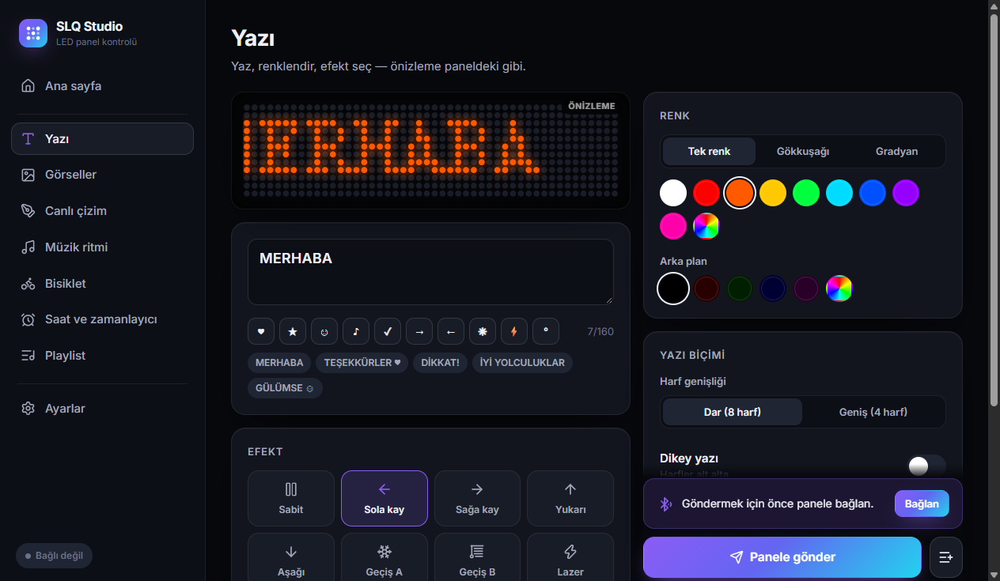
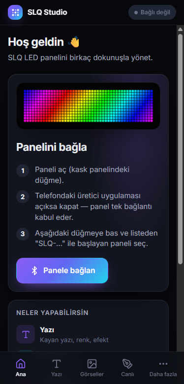

# SLQ LED Panel — SLQ Studio uygulaması ve açık protokol

[](https://github.com/civaninatolyesi/slq-led-panel/actions/workflows/release.yml)
[](https://github.com/civaninatolyesi/slq-led-panel/releases/latest)
[](https://civaninatolyesi.github.io/slq-led-panel/)
[](LICENSE)

Sanluqi (SLQ) marka 48×12 RGB LED kask panellerini üreticinin uygulamasına bağlı kalmadan kontrol etmek için
açık kaynak uygulama (**SLQ Studio**), Bluetooth protokolünün açık spesifikasyonu ve Python referans istemcisi.

> **English:** SLQ Studio is an open-source controller for SLQ/Sanluqi 48×12 LED helmet panels. It runs on
> Windows, Linux, macOS, Android and in Chrome/Edge, and supports every panel feature: text with effects,
> GIFs and animations, live drawing, music visualiser, bike signals, clock, schedule and playlists.
> Download it from [**Releases**](https://github.com/civaninatolyesi/slq-led-panel/releases/latest) or open the [web version](https://civaninatolyesi.github.io/slq-led-panel/) in Chrome/Edge. The app UI is available in English and Turkish.

<p>
  
  
</p>

## SLQ Studio'yu indir

Hepsi [**Releases**](https://github.com/civaninatolyesi/slq-led-panel/releases/latest) sayfasında.

| Cihaz | Dosya |
|---|---|
| Windows 10/11 | `SLQ-Studio-x.y.z-win-x64.exe` (kurulum) · `SLQ-Studio-x.y.z-portable.exe` (kurulumsuz) |
| Linux | `.AppImage` · `.deb` |
| Android 7+ | `SLQ-Studio-x.y.z-android.apk` |
| macOS | `.dmg` |
| Kurulumsuz | [Web sürümü](https://civaninatolyesi.github.io/slq-led-panel/) — Chrome ya da Edge ile, masaüstü ve Android |

Kullanım: paneli aç → telefondaki üretici uygulamasını kapat (panel tek bağlantı kabul eder) →
**Panele bağlan** → listeden `SLQ-…` panelini seç. Ayrıntılar ve sorun giderme: [uygulama rehberi](docs/app.md).

| | |
|---|---|
| **Durum** | Protokol çözüldü ve donanımda doğrulandı (2026-11-02). SLQ Studio donanım testi: 20/20 |
| **Hedef donanım** | SLQ-xxxxxx paneller, 48×12 RGB, firmware 1.0.6 (JieLi BLE SoC) |
| **Uygulama** | React + TypeScript; Electron (masaüstü), Capacitor (Android), PWA (tarayıcı) |
| **Referans istemci** | Python 3.11+, [bleak](https://github.com/hbldh/bleak), Pillow |
| **Kaynak** | Üretici uygulaması v1.0.8'in tersine mühendisliği + donanım testleri |

## Desteklenen özellikler

| Özellik | Durum | Özellik | Durum |
|---|---|---|---|
| Parlaklık, ekran aç/kapa, 180° döndürme | ✅ | Müzik ritmi (5 ekolayzır stili) | ✅ |
| Metin (Türkçe dahil), 8 efekt, hız, renk, gradyan, dikey yazı | ✅ | Bisiklet modu (sinyal, hız göstergesi) | ✅ |
| Statik ve animasyonlu GIF (48×12) | ✅ | Playlist (panel kendi döndürür) | ✅ |
| Canlı piksel çizimi, ayna, silgi | ✅ | Saat göstergesi (4 tasarım) | ✅ |
| Otomatik aç/kapa zamanlayıcısı | ✅ | Durum sorgusu (sürüm, şifre, parlaklık) | ✅ |
| Resim efektleri | ❌ bu firmware'de yok | Kumanda yuvaları | ❌ bu modelde yok |

Ayrıntılar ve kanıtlar: [doğrulama raporu](docs/verification/2026-11-02-report.md).

## Python istemcisi

```bash
pip install -r requirements.txt

python tools/slq_cli.py scan                               # yakındaki panelleri bul
python tools/slq_cli.py --addr 71:85:ED:B5:55:F7 info      # bağlan, durum sorgula
python tools/slq_cli.py text "MERHABA" --color 00ff00 --effect LEFT
python tools/slq_cli.py gif animasyon.gif
```

> Panel aynı anda yalnızca **bir** BLE bağlantısı kabul eder. Telefondaki üretici uygulaması bağlıysa
> bilgisayar paneli göremez.

Kütüphane olarak:

```python
import asyncio
from slq import Panel, encode_gif, solid, protocol as P

async def main():
    async with Panel("71:85:ED:B5:55:F7") as panel:
        await panel.command(P.brightness(60))
        await panel.send_text("SELAM", rgb=(255, 128, 0), effect=P.Effect.LEFT)
        await panel.send_gif(encode_gif([solid((0, 0, 255))]))

asyncio.run(main())
```

## Depo yapısı

```
app/                    SLQ Studio (masaüstü, Android, web) — docs/app.md
  src/core/             protokolün TypeScript portu (Python ile bayt bayt aynı, testli)
  src/ble/              Web Bluetooth / Android BLE taşıması, panel oturumu
  electron/  android/   platform kabukları
slq/                    Python referans istemcisi
  protocol.py           sabitler, CRC'ler, çerçeve ve komut kurucular, cevap çözücü
  text.py               metin -> glif kodlama (yerleşik font + bitmap)
  media.py              48x12 GIF üretimi
  ble.py                bağlantı, notify kuyruğu, transfer akışları (Panel sınıfı)
  data/font12.json      üretici uygulamasından çıkarılan 6x12 font tablosu
tools/
  slq_cli.py            komut satırı aracı
  slq_test.py           tarayıcı arayüzlü donanım doğrulama paketi
  gen_test_vectors.py   uygulama testleri için Python referans vektörleri
docs/                   spesifikasyon, rehberler, doğrulama raporları
.github/workflows/      test, paketleme, GitHub Release ve Pages
vendor/                 üretici APK'sı (depoya dahil edilmez)
```

## Dokümantasyon

| Belge | İçerik |
|---|---|
| [Uygulama rehberi](docs/app.md) | SLQ Studio kullanımı, mimarisi, derleme ve sürüm yayınlama |
| [docs/README.md](docs/README.md) | Belge dizini ve okuma sırası |
| [Protokol spesifikasyonu](docs/protocol/01-transport.md) | Taşıma, çerçeveleme, komutlar, transferler, veri biçimleri |
| [Komut referansı](docs/protocol/03-commands.md) | Her komutun bayt düzeni, cevabı ve doğrulama durumu |
| [Geliştirici rehberi](docs/development.md) | Python kurulumu, kütüphane API'si, araçlar, yeni komut ekleme |
| [Tersine mühendislik notları](docs/reverse-engineering.md) | Kaynak sınıf haritası, uygulama ile firmware arasındaki farklar |
| [CHANGELOG](CHANGELOG.md) | Sürüm geçmişi |
| [CONTRIBUTING](CONTRIBUTING.md) · [SECURITY](SECURITY.md) | Katkı rehberi, güvenlik kuralları ve açık bildirme |

## Güvenlik

- **AE01/AE02 (JieLi OTA) karakteristiklerine yazılmaz.** Ne kütüphane ne uygulama bu yolu sunar; yanlış veri paneli kalıcı olarak bozabilir.
- `52` (şifre koy) ve `57` (sol/sağ panel tipi) komutları denenmedi. Paneli kilitleyebilir ya da yanlış yapılandırabilir. Uygulamanın geliştirici konsolu bunları engeller.
- `50` (reset) panel ayarlarını sıfırlar; uygulamada onay ister.

## Katkı

Hata bildirimi, farklı panel/firmware raporları ve kod katkıları için [CONTRIBUTING.md](CONTRIBUTING.md).
Özellikle başka model ya da firmware'li panelin varsa "Panel uyumluluğu" issue'su çok değerli.

## Lisans

[MIT](LICENSE) © 2026 civaninatolyesi

## Yasal not

Bu çalışma, sahibi olunan cihazlarla birlikte çalışabilirlik (interoperability) amacıyla yapılmıştır ve
üreticiyle bağlantısı yoktur. Üretici APK'sı ve ondan türetilen kaynak kod depoda dağıtılmaz; yalnızca
protokol bilgisi ve font tablosu (işlevsel veri) belgelenmiştir. Uygulamadaki animasyonlar kodla üretilir.
