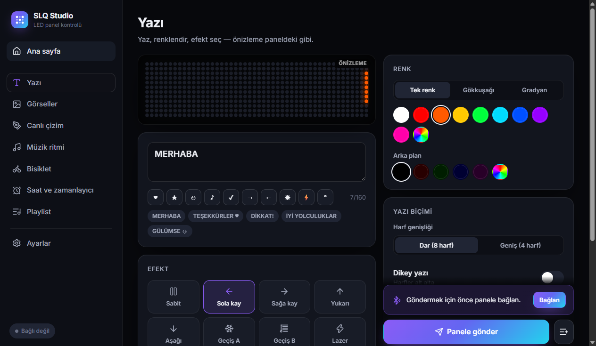
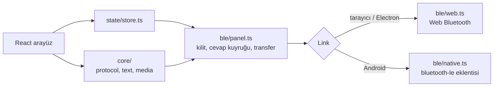

# SLQ Studio — uygulama rehberi

SLQ Studio, panelin bütün özelliklerini tek bir arayüzden kullandıran açık kaynak kontrol uygulamasıdır.
Aynı kod Windows, Linux, macOS, Android ve tarayıcıda çalışır.



## 1. Kullanıcılar için

### Hangi sürümü indirmeliyim?

| Cihaz | İndir | Not |
|---|---|---|
| Windows 10/11 | `SLQ-Studio-x.y.z-win-x64.exe` (kurulum) ya da `…-portable.exe` (kurulumsuz) | İmzasız olduğu için SmartScreen uyarı verebilir: **Ek bilgi → Yine de çalıştır** |
| Linux | `…-linux-x86_64.AppImage` ya da `.deb` | AppImage: `chmod +x` ve çalıştır. BlueZ 5.50+ gerekir |
| Android 7+ | `SLQ-Studio-x.y.z-android.apk` | "Bilinmeyen kaynaklardan yükleme" izni istenir. Bluetooth ve konum izni verilmeli |
| macOS | `….dmg` | İmzasız: ilk açılışta sağ tık → Aç |
| Kurulum istemeyenler | [https://civaninatolyesi.github.io/slq-led-panel/](https://civaninatolyesi.github.io/slq-led-panel/) | Masaüstü ve Android'de **Chrome ya da Edge** gerekir; menüden "Uygulamayı yükle" ile ana ekrana eklenir. iPhone'daki Safari Bluetooth desteklemez |

Hepsi [Releases](https://github.com/civaninatolyesi/slq-led-panel/releases/latest) sayfasındadır.

### İlk bağlantı

1. Paneli aç.
2. Telefondaki üretici uygulaması bağlıysa kapat. **Panel aynı anda tek cihaza bağlanır**; başka bir cihaz bağlıyken panel taramada görünmez.
3. Uygulamada **Panele bağlan**'a bas, listeden `SLQ-…` adlı paneli seç.

Uygulama son paneli hatırlar ve sonraki açılışlarda kendiliğinden bağlanmayı dener. Bağlantı koparsa
arka planda yeniden bağlanır (üst köşedeki durum göstergesi sarı yanar).

### Özellikler

| Ekran | Ne yapar |
|---|---|
| **Ana sayfa** | Ekranı aç/kapa, parlaklık, 180° çevirme, hızlı yazı, tek dokunuşla animasyonlar, fabrika demolarına dönüş |
| **Yazı** | Türkçe dahil her karakter; tek renk, harf başına gökkuşağı ya da panelin hazır gradyanları; arka plan rengi; 8 efekt; hız; dar (8 harf) ya da geniş (4 harf) yazı; dikey yazı. *Anında uygula* açıkken gönderilmiş yazının efekt/renk/hız değişiklikleri yazı yeniden yüklenmeden panele yansır |
| **Görseller → Galeri** | 17 hazır animasyon (gökkuşağı, alev, dijital yağmur, kalp, gözler, sinyal okları, fren lambası, çakar, plazma…). Renk değiştirilebilir |
| **Görseller → Dosyadan** | PNG, JPG, GIF, WebP (animasyonlu dahil) dosyasını 48×12'ye sığdırır. Dosya zaten 48×12 GIF ise olduğu gibi gönderilir |
| **Görseller → Stüdyo** | Kare kare piksel animasyon editörü: kalem, silgi, doldurma, renk alma, önceki kareyi gösterme, kaydırma, kare süresi. Çizim cihazda saklanır |
| **Canlı çizim** | Dokunduğun piksel anında panelde yanar; yatay/dikey simetri panelin kendisi tarafından çizilir |
| **Müzik ritmi** | Mikrofon, müzik dosyası ya da (Windows'ta) bilgisayar sesi; 5 görünüm, hassasiyet ayarı. Sayfadan çıkınca da çalmaya devam eder |
| **Bisiklet** | Sol/sağ sinyal, sürüş, durma; hız göstergesi (elle ya da telefon GPS'iyle). Masaüstünde ok tuşları kısayoldur |
| **Saat ve zamanlayıcı** | Panelin 4 saat tasarımı (panel saati cihazdan ayarlanır); her gün otomatik açılma/kapanma saati |
| **Playlist** | Yazı ve görselleri sıraya koyar, panele yükler; panel öğeler arasında kendisi geçer, cihazın bağlı kalması gerekmez |
| **Ayarlar** | Dil (Türkçe/İngilizce), tema, panel bilgisi, panel ayarlarını sıfırlama, geliştirici konsolu (BLE trafiği, ham komut) |

### Sorun giderme

| Belirti | Çözüm |
|---|---|
| Panel listede görünmüyor | Üretici uygulamasını kapat ya da telefonun Bluetooth'unu kapat. Panel kopmadan sonra ~30 sn içinde yeniden görünür |
| Tarayıcıda "Bluetooth desteklenmiyor" | Chrome ya da Edge kullan. Linux'ta Chrome için `chrome://flags/#enable-experimental-web-platform-features` açılmalı ya da masaüstü uygulaması kullanılmalı |
| Android'de tarama boş | Bluetooth ve konum servisi açık olmalı; uygulama izinlerinde "Yakındaki cihazlar" ve "Konum" verilmeli |
| Gönderim yarıda kaldı | Paneli cihaza yaklaştır, tekrar gönder. Büyük animasyonlar (30+ parça) birkaç saniye sürer |
| Sağa kayan yazı | Panel bu efektte harf sırasını ters gösterir; uygulama bunu düzeltmek için yazıyı ters gönderir |

## 2. Geliştiriciler için

### Mimari

```
app/
  src/core/        protokol (slq/protocol.py'nin birebir portu), metin/glif kodlama, GIF, animasyonlar, önizleme
  src/ble/         taşıma katmanı: web.ts (Web Bluetooth: tarayıcı + Electron), native.ts (Android), panel.ts (oturum)
  src/state/       uygulama durumu (zustand), müzik ritmi motoru
  src/pages/       ekranlar
  src/ui/          ortak bileşenler (LED matris çizici, piksel tuvali, kontroller)
  electron/        masaüstü kabuğu: Web Bluetooth cihaz seçimini arayüze taşır
  android/         Capacitor Android projesi
  scripts/         simge üretimi, ekran görüntüsü, donanım duman testi
```



- **Tek kod tabanı:** arayüz ve protokol her platformda aynıdır; yalnızca `Link` uygulaması değişir.
- **Electron:** Chromium'un Web Bluetooth'u kullanılır. Electron'da cihaz seçici olmadığı için ana süreç
  `select-bluetooth-device` olayını yakalar ve listeyi uygulamanın kendi penceresinde gösterir.
  Otomatik yeniden bağlanmada `requestDevice` "kullanıcı hareketi" istediğinden çağrı ana süreçten
  `executeJavaScript(…, userGesture = true)` ile yapılır.
- **Android:** `@capacitor-community/bluetooth-le` bağlanınca MTU 512 ister, parça boyutu 446 bayt kalır.
- **Tarayıcı:** Web Bluetooth MTU bildirmez. İlk parça geçmezse `Panel` parça boyutunu 446 → 160 → 7 düşürerek yeniden dener.
- **Sıralama:** BLE aynı anda tek GATT işlemi kabul eder. `Panel.exclusive()` tüm işlemleri sıraya koyar;
  kaydırıcı, ritim ve hız gibi sık güncellenen değerler `sendLatest()` ile birleştirilir (yalnızca en yeni değer gider).
- **Güvenlik:** AE01 (OTA) karakteristiği kodda tanımlı değildir. Geliştirici konsolu `52` (şifre) ve `57` (panel tipi) komutlarını engeller. Reset onay ister.

### Protokolden farklı ya da yeni olanlar

| Konu | Açıklama |
|---|---|
| Dar Türkçe glifler | Üretici fontu yalnızca ASCII içerir. Ç Ş Ğ Ü Ö İ ç ş ğ ü ö ı, temel harfe aksan eklenerek 6×12 TİP 3 glif olarak üretilir (`core/text.ts`). Boşluk da dar glif olarak gider. Donanımda doğrulandı (2026-11-02) |
| GIF kodlama | Kare başına palet; renk sayısı ≤ 64 ise birebir palet, değilse niceleme |
| Sağa kayma | Yazı panele ters sırayla gönderilir, böylece doğru okunur |

### Komutlar

```bash
cd app
npm install
npm run dev              # tarayıcıda geliştirme: http://localhost:5173 (Chrome/Edge)
npm run electron:dev     # masaüstü kabuğuyla geliştirme
npm test                 # protokol portunu Python referansıyla karşılaştırır
npm run typecheck
npm run dist:win         # release/ altında .exe (kurulum + portable)
npm run dist:linux       # AppImage + deb (Linux'ta çalıştır)
npm run android:sync     # web derlemesini Android projesine kopyalar
npm run android:open     # Android Studio'da açar (APK: Build → Build APK)
npm run hwtest -- SLQ-B555F7   # gerçek panelde duman testi (20 adım)
```

> VS Code'un tümleşik terminali `ELECTRON_RUN_AS_NODE=1` tanımlar ve Electron'u Node gibi çalıştırır.
> Electron komutlarından önce bu değişkeni kaldır: PowerShell'de `Remove-Item Env:ELECTRON_RUN_AS_NODE`,
> bash'te `unset ELECTRON_RUN_AS_NODE`.

### Testler

| Test | Ne doğrular |
|---|---|
| `src/core/protocol.test.ts` | 25 komut çerçevesi, CRC'ler, parçalama, 91 font glifi ve metin kodlaması Python istemcisiyle bayt bayt aynı. Vektörler: `python tools/gen_test_vectors.py` |
| `scripts/hwtest.cjs` | Derlenmiş uygulamayı panele bağlar ve her özelliği dener (cevap ve parça onaylarını denetler) |

Son donanım testi (2026-11-02, SLQ-B555F7, Windows, Electron Web Bluetooth): **20/20 adım başarılı.**
13 KB'lık 30 parçalı animasyon 4,6 sn'de yüklendi. Ayrıntılar: [doğrulama raporu](verification/2026-11-02-app-report.md).

### Kimlikler

| | |
|---|---|
| Uygulama kimliği (Android paketi, Electron appId) | `io.github.civaninatolyesi.slqstudio` — yayından sonra **değiştirilmez**, değişirse kullanıcılar güncelleme alamaz |
| Sürüm | `app/package.json` `version`; CI etiketten (`v1.2.3`) alır. Android `versionCode` = 10000·ana + 100·ara + yama |

### Sürüm yayınlama

`.github/workflows/release.yml`:

| Tetik | Sonuç |
|---|---|
| Her push / PR | tip kontrolü, testler, derleme |
| `main` dalına push | web sürümü GitHub Pages'e yayınlanır (depo ayarlarında Pages kaynağı "GitHub Actions" olmalı) |
| `v1.2.3` etiketi | Windows, Linux, macOS ve Android paketleri derlenir, GitHub Release'e eklenir |

İlk yayın:

```bash
git remote add origin https://github.com/civaninatolyesi/slq-led-panel.git
git push -u origin main
# GitHub → Settings → Pages → Source: "GitHub Actions"
git tag v1.0.0 && git push origin v1.0.0
```

Android APK'sını kendi anahtarınla imzalamak için depo gizli değişkenleri: `ANDROID_KEYSTORE_BASE64`,
`ANDROID_KEYSTORE_PASSWORD`, `ANDROID_KEY_ALIAS`, `ANDROID_KEY_PASSWORD`. Tanımlı değilse APK hata ayıklama
anahtarıyla imzalanır; kurulabilir ama sonraki sürümler farklı anahtarla gelirse önce eski sürüm kaldırılmalıdır.

### Yeni özellik ekleme

1. Komutu `docs/protocol/03-commands.md`'ye ve Python'a ekle (bkz. [geliştirici rehberi](development.md#yeni-komut-ekleme)).
2. Aynı kurucuyu `app/src/core/protocol.ts`'ye ekle, `tools/gen_test_vectors.py`'ye bir vektör ekleyip testleri çalıştır.
3. Arayüzü `app/src/pages/` altında ilgili ekrana ekle. Metinler `t('Türkçe', 'English')` biçimindedir.
4. `scripts/hwtest.cjs`'ye bir adım ekle ve panelde çalıştır.
