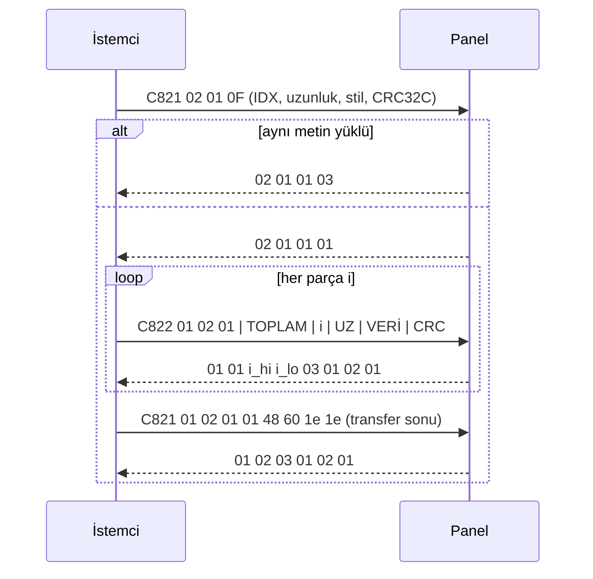
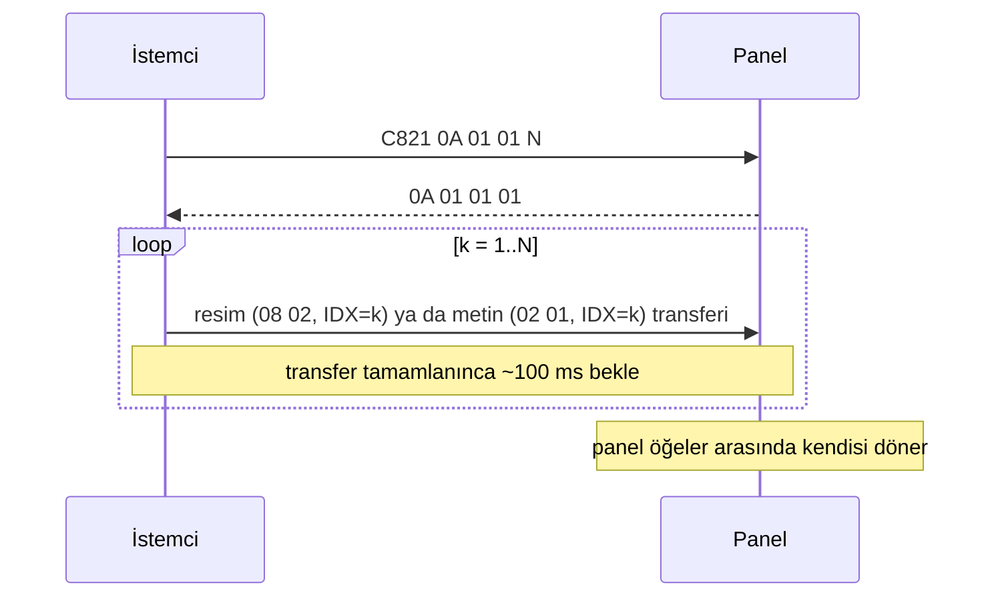

# 4. Veri transferi

Metin ve resimler, kısa komutlara sığmadığı için iki kanallı bir akışla yüklenir:
kontrol C821/C823 üzerinden, veri C822 üzerinden gider.

## 4.1 Parça (chunk) biçimi — C822

```
+----+----+----+----------------+---------------+---------------+--------------+----------+
| H0 | H1 | H2 | TOPLAM (u32 BE) | NO (u16 BE)   | UZUNLUK (u16 BE) | VERİ        | CRC16 BE |
+----+----+----+----------------+---------------+---------------+--------------+----------+
  3 bayt          4                2               2                ≤ 446          2
```

| Alan | Açıklama |
|---|---|
| H | `01 02 01` metin, `01 08 02` resim |
| TOPLAM | verinin tamamının uzunluğu (her parçada aynı) |
| NO | 0'dan başlayan parça numarası |
| UZUNLUK | bu parçadaki VERİ uzunluğu; sonuncusu dışında 446 |
| CRC16 | H0'dan VERİ sonuna kadar CRC-16/MODBUS, yüksek bayt önce |

C822 yazmaları kendi başına cevap üretmez. Onay C823'ten gelir.

## 4.2 Metin



Metin verisinin içeriği: [5.1 Metin kodlama](05-data-formats.md#51-metin-kodlama).

Gözlenen örnek (HELLO, TİP 4, 80 bayt):

```
>> c821  02 01 0f 00 00 50 00 64 00 00 00 00 00 00 d7 2a 82 67 6f d6
<< c823  02 01 01 01 0c 90
>> c822  01 02 01 00 00 00 50 00 00 00 50 03 ff 00 00 … ed 43
<< c823  01 01 00 00 03 01 02 01 23 00
>> c821  01 02 01 01 48 60 1e 1e
<< c823  01 02 03 01 02 01 2e e9
```

## 4.3 Resim (GIF)

Akış metinle aynıdır. Farklar:

| | Metin | Resim |
|---|---|---|
| Başlat | `02 01 0F …` | `08 02 05 IDX CRC32C` |
| "Gönder" cevabı | `02 01 01 01` | `08 02 01 01` |
| Parça başlığı | `01 02 01` | `01 08 02` |
| Parça onayı | `01 01 NO 03 01 02 01` | `01 01 NO 03 01 08 02` |
| Sonuç | `01 02 03 01 02 01` | `01 02 03 01 08 02` |

Veri, GIF dosyasının baytlarıdır: [5.2 GIF kuralları](05-data-formats.md#52-gif).

## 4.4 Playlist



Liste `0A 02 01 00` ile temizlenir. Bundan sonra panel fabrika demo animasyonlarını oynatır.

## 4.5 Hata durumları

| Durum | Panel davranışı | İstemcinin yapacağı |
|---|---|---|
| Başlat komutuna cevap yok (4 s) | — | Transferi iptal et. Kumanda ailesi (`18`) bu modelde hep sessizdir |
| ST=3 | parça istemez | Başarılı say, içerik zaten yüklü |
| Parça onayı gelmedi (4 s) | — | İptal et. Uygulama yeniden göndermiyor; yeniden deneme politikası tanımlı değil |
| `01 02 01 XX` (XX > 1) | veri hatası (APK) | İptal et |
| Bağlantı koptu | transfer yarım kalır | Yeniden bağlan, transferi baştan başlat |

Aynı içeriği yeniden göstermek gerekiyorsa (ör. efekt denemelerinde) CRC32C değişsin diye içerikte
küçük bir fark yaratılmalıdır. Aksi halde panel ST=3 döner ve ekranı güncellemez.

## 4.6 Açık konular

- Tek CRC'li transfer sonu çerçevesi (`01 02 01 01 48 60`) kabul ediliyor mu?
- 446 bayttan büyük parçalar (MTU 517) kabul ediliyor mu? Daha büyük parçalar yüklemeyi hızlandırır.
- Panelin saklayabileceği en büyük GIF boyutu ve playlist öğe sayısı.
